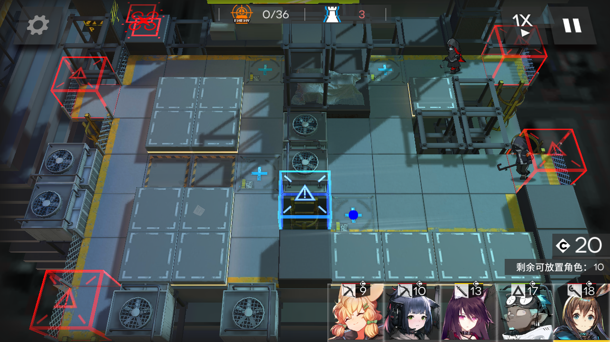
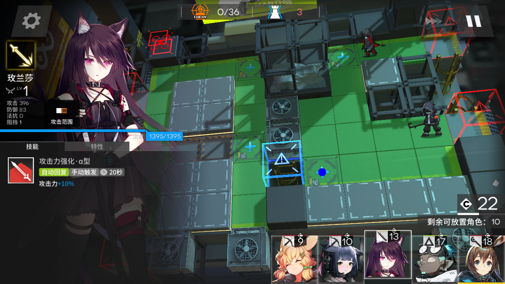
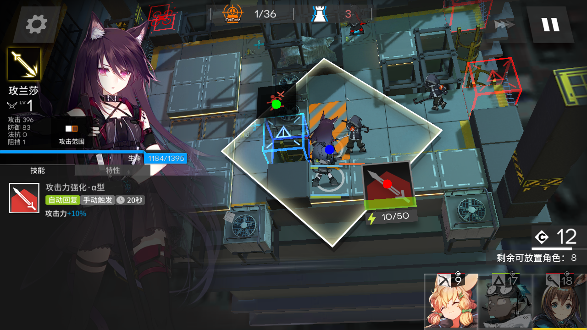
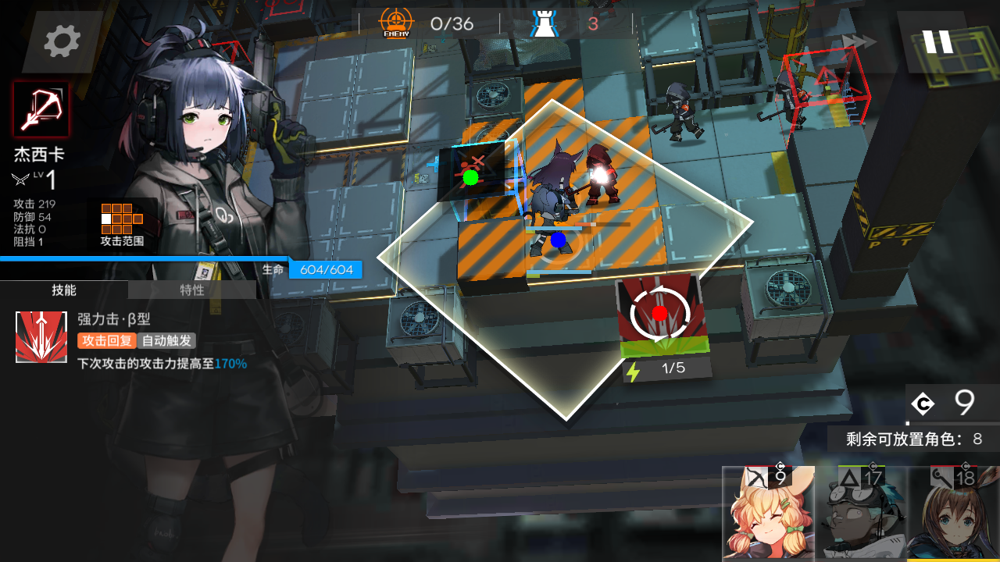

# Arknights-Tile-Pos
识别明日方舟地图中的格子坐标  
--
## 地图数据
[github](https://raw.githubusercontent.com/yuanyan3060/Arknights-Bot-Resource/main/levels.json)
[fastgit](https://raw.fastgit.org/yuanyan3060/Arknights-Bot-Resource/main/levels.json)

## 已经支持的内容
- 所有的地图（除非鹰角修改了这部分代码）
- 所有的分辨率 (鹰角支持的，此程序都能支持)
- 包括放置干员时的倾斜视角 技能按钮 撤退按钮

## 卫戍协议
使用更新后包含 `act3autochess` 完整地图的 `levels.json`，支持第一子图的商店／手牌准备稳态：

```python
from main import AutoChessView, Calc

calc = Calc(1280, 720, level)
shop = calc.get_autochess_screen_pos(4, 32, AutoChessView.SHOP)
hand = calc.get_autochess_screen_pos(4, 32, AutoChessView.HAND)
```

坐标为完整地图左上角起算的列、行；第一子图局部 `(4, 3)` 对应完整地图 `(4, 32)`。暂不支持卫戍协议的其他子图、战斗和角色选中机位，以及技能／撤退按钮坐标。

其他平台同样使用完整地图数据：Auto.js 调用 `get_autochess_screen_pos(col, row, "shop"/"hand")`；C++、按键精灵和 Arklights 的 `side=false/true` 分别选择商店／手牌。两个 Python 导出版本可通过 `run(stage_id="act3autochess_m01", side=False)` 按关卡 ID 选择，按键精灵保留原有的竖屏坐标约定。

## 特色
使用矩阵计算而不是图色识别，准确率可达100%  
图色识别是有极限的，我不做图色识别了，jojo(bushi)

## 后记
代码本身没什么好说的，关键是代码背后的东西。  
如果你的产品或项目，直接或间接使用了本仓库中的内容  
请注明出处并包括github url: https://github.com/yuanyan3060/Arknights-Tile-Pos


## 示例
  
  
  
  
